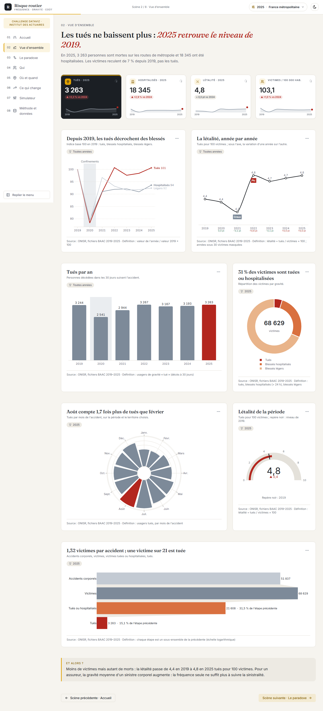

# Risque routier — fréquence, gravité, coût

Application Dash + Dash Mantine Components qui raconte en **8 scènes** le risque corporel routier en
France métropolitaine de **2019 à 2025**, du point de vue d'un actuaire qui présente au comité de
direction d'un assureur auto. Message central : *le nombre d'accidents ne dit pas où est le risque ; le
risque, c'est la fréquence multipliée par la gravité, et les deux ne sont pas au même endroit.*

Version portfolio d'un projet préparé pour le Challenge Dataviz de l'Institut des Actuaires.



## Installation

Prérequis : Python 3.11 ou plus récent (développé sous 3.13.9), Windows, macOS ou Linux.

```bash
python -m venv .venv
# Windows : .venv\Scripts\activate    ·    macOS / Linux : source .venv/bin/activate
pip install -r requirements.txt
```

Les données brutes ne sont pas versionnées : placez-les dans `data/` selon l'inventaire de
`LISEZMOI.txt` (`data/baac/<année>/`, `data/meteo/`, `data/insee/`, `data/sdes/`, `data/geo/`).

## Lancement

```bash
python -m pipeline.run      # reconstruit data/processed/ (environ 1 min 30) et reports/controles.md
python app/app.py           # http://127.0.0.1:8050
```

Variables utiles : `DASH_DEBUG=0` (mode production), `DASH_QA=1` (sans barre d'outils de debug).

### Connexion

Le tableau de bord est protégé par une page de connexion. Identifiants de démonstration
(affichés sur la page, projet portfolio) : **`actuaire`** / **`risque2026`**.
Surchargeables par variables d'environnement avant le lancement :
`APP_UTILISATEUR`, `APP_MOTDEPASSE`, et `APP_SECRET` (clé de signature du cookie de session).
`APP_AUTH=0` désactive la garde (QA automatisée, développement).
Langue de l'interface : bascule **FR / EN** en haut à droite (connexion et tableau de bord).

## Vérifications

```bash
pytest -q                   # contrats de données, formules, seuil G6, design (G9), formats
ruff check .                # style
python sandbox/qa_filtres.py   # 8 pages × 5 combinaisons de filtres, erreurs de callback
python sandbox/qa_screens.py http://127.0.0.1:8050 reports/screens/final nom=/chemin ...
python sandbox/qa_perf.py   # premier affichage et durée des callbacks
```

## Les 8 scènes

| # | Scène | Ce qu'on y voit |
| --- | --- | --- |
| 01 | Accueil | Chiffre héros (tués de la dernière année), triptyque Fréquence · Gravité · Coût |
| 02 | Vue d'ensemble | KPI, base 100, létalité année par année, tués par an, répartition par gravité, saisonnalité, jauge |
| 03 | Le paradoxe | Agglomération / hors agglomération, barres miroir par route, létalité par vitesse, lumière, obstacle, matrice route × lumière |
| 04 | Qui | Risque grave par âge et sexe, matrice fréquence × gravité, âges des tués (boîtes), matrice mode × âge, radar par contexte |
| 05 | Où et quand | Carte des départements + classement, dispersion annuelle, calendrier, heatmap jour × heure, effet météo (GLM) |
| 06 | Ce qui change | Petits multiples base 100, pente 2019 → 2025, répartition des tués par mode, Pareto de la gravité |
| 07 | Simulateur | Risque relatif de blessure grave d'un profil (régression logistique calculée dans le navigateur) |
| 08 | Méthode et données | Sources, définitions, corrections, limites, contrôles, table complète exportable en CSV |

Filtres globaux (en-tête) : période (une année ou le cumul 2019–2025) et territoire (France
métropolitaine ou un département), conservés dans l'URL (`?annee=2025&dep=29`) et la session.

## Architecture

```
pipeline/   lecture brute, corrections, table usager enrichie, agrégats Parquet, GLM (indépendant de Dash)
design/     tokens, thème Mantine, templates Plotly, illustration du héros, illustrations véhicules 3D (vehicules.py)
app/        app.py, data_access.py (Parquet en cache), figures.py, components/, pages/, assets/
            echarts.py (jauges, rose, radar) ; ECharts 5.5.1 local dans assets/vendor/ (Apache-2.0)
            assistant.py (assistant RAG ancré aux données : questions en langage naturel)
tests/      contrats de données, formules, design, formats
sandbox/    démos des composants (données factices) et scripts de QA (playwright)
reports/    inventaire, contrôles G4, décisions, rapports de phase, captures, synthèse
```

## Sources

- ONISR — bases de données annuelles des accidents corporels de la circulation (BAAC), 2019–2025.
- INSEE — estimations de population au 1er janvier par département, sexe et âge.
- SDES — parc de véhicules en circulation au 1er janvier.
- Météo-France — données climatologiques quotidiennes, agrégées par département.
- Contours des départements : france-geojson (Grégoire David).

## Limites

- Pas de données d'assurance : le coût socio-économique n'est pas le coût pour un assureur, et les
  valeurs tutélaires de coût restent « À renseigner » dans `config/references.yaml`.
- Seuls les accidents corporels constatés par les forces de l'ordre sont recensés ; blessés légers
  sous-déclarés ; « blessé hospitalisé » non labellisé depuis 2019.
- Exposition approchée par la population (et le parc pour les véhicules), faute de kilomètres
  parcourus ; pas de parc de deux-roues motorisés par département.
- Météo moyennée par département et par jour ; modèles = associations, pas causalités.
- 2020 atypique (confinements) ; usagers en fuite sans âge ni sexe depuis 2021 ; populations INSEE
  2024–2025 provisoires.
- Un taux calculé sur moins de 30 victimes n'est jamais affiché.
- **Bilingue FR/EN** : le cadre applicatif (en-tête, navigation, filtres, assistant, boutons),
  la page de connexion et le **simulateur** sont entièrement traduits. Les titres-messages
  analytiques des scènes 02–06 sont générés depuis les données (G3) et restent en français :
  leur version anglaise doit être validée par le propriétaire (un titre doit refléter les
  données). L'assistant comprend les mots-clés français. Extension : ajouter les clés dans
  `app/i18n.py` et brancher les textes de scène sur `i18n.t()` / une branche `i18n.langue()`.

## Captures

Toutes les scènes, en clair et en sombre, à 1440, 1024 et 390 px : [reports/screens/final/](reports/screens/final/).
